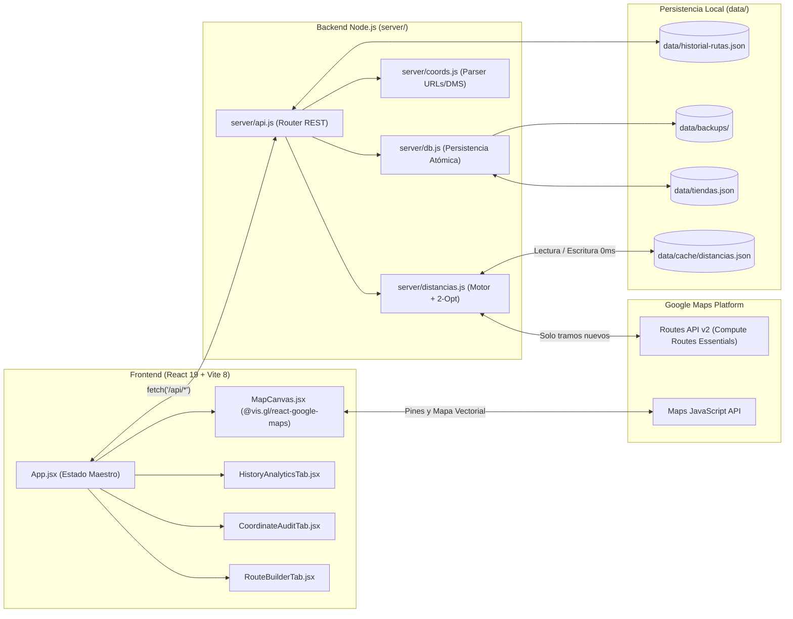

# Arquitectura Técnica y Referencia Interna — Rutas Sureste

Este documento describe en detalle el funcionamiento interno del sistema **Rutas Sureste**, el flujo de datos entre el frontend en React y el backend en Node.js, la especificación de los endpoints REST y los algoritmos utilizados.

---

## 1. Diagrama de Arquitectura General



---

## 2. Cómo se conectan Vite y el Backend (`vite.config.js` vs `server/index.js`)

El backend está diseñado como un **middleware puro de Node.js** (`handleApiRequest(req, res)` en [`server/api.js`](../server/api.js)) sin depender de frameworks externos como Express. Esto permite dos modos de ejecución idénticos:

1. **Modo Desarrollo (`pnpm dev`)**:
   - Vite levanta el servidor en `http://localhost:5173`.
   - El plugin `rutasSuresteApiPlugin` en [`vite.config.js`](../vite.config.js) intercepta cualquier petición que empiece con `/api/` y la delega directamente a `handleApiRequest(req, res)`.
   - Así tienes *Hot Module Replacement (HMR)* en React y persistencia real en `data/` desde un solo proceso.

2. **Modo Producción (`pnpm start`)**:
   - `vite build` genera los archivos estáticos optimizados en `dist/`.
   - [`server/index.js`](../server/index.js) levanta un servidor `node:http` nativo en `http://localhost:3000` que sirve tanto los archivos estáticos de `dist/` como los endpoints `/api/*`.

---

## 3. Referencia Completa de Endpoints REST (`server/api.js`)

### `GET /api/config`
Devuelve la configuración inicial para el cliente web y el estado actual del motor de ruteo.
- **Respuesta**:
  ```json
  {
    "mapsKey": "AIzaSy...",
    "kmPorLitro": 12.5,
    "precioLitro": 23.99,
    "motor": {
      "apiKey": true,
      "routes": true,
      "motor": "routes",
      "ultimoError": null,
      "tramosEnCache": 46
    }
  }
  ```

### `GET /api/tiendas`
Lee y devuelve el arreglo completo de tiendas desde `data/tiendas.json`.
- **Formato de cada tienda**:
  ```json
  {
    "nombre": "OCOZOCOAUTLA CENTRO",
    "coords": "16.7623410,-93.3681240",
    "estado": "Chiapas",
    "verificada": true,
    "fechaVerificacion": "2026-10-05",
    "coordsAnteriores": "16.7610000,-93.3690000"
  }
  ```

### `POST /api/tiendas`
Da de alta una nueva tienda en el catálogo.
- **Body**: `{ "nombre": "VILLAHERMOSA CENTRO", "estado": "Tabasco", "lat": 17.989456, "lng": -92.947506, "verificada": true }`
- **Efectos**:
  - Crea un respaldo automático en `data/backups/`.
  - Normaliza el nombre a mayúsculas y ordena alfabéticamente el catálogo manteniendo `RESGUARDO` en la primera posición.

### `PATCH /api/tiendas`
Actualiza nombre, estado, coordenadas o estado de verificación de una tienda existente.
- **Body**: `{ "nombreOriginal": "9 SUR", "nombre": "9 SUR", "estado": "Chiapas", "lat": 16.745388, "lng": -93.113217, "verificada": true }`
- **Efectos clave sobre la caché**:
  - Si las coordenadas cambiaron más de `0.00001` grados (~1.1 metros), guarda la coordenada original en `coordsAnteriores` e **invalida únicamente los tramos en caché que tocaban la coordenada vieja** mediante `dist.invalidarPunto(prev)`.

### `DELETE /api/tiendas`
Elimina una tienda del catálogo previo respaldo automático en `data/backups/`.
- **Body**: `{ "nombre": "NOMBRE DE TIENDA" }`

### `POST /api/ruta`
Calcula todos los tramos consecutivos de una secuencia de puntos `[P0, P1, P2, ..., Pn]`.
- **Body**: `{ "puntos": [{ "lat": 16.782074, "lng": -93.123710 }, { "lat": 16.762341, "lng": -93.368124 }] }`
- **Respuesta**:
  ```json
  {
    "tramos": [
      {
        "metros": 34210,
        "segundos": 2140,
        "km": 35,
        "polyline": "m~deB...",
        "fuente": "routes",
        "cache": true
      }
    ],
    "motor": { "apiKey": true, "routes": true, "motor": "routes", "tramosEnCache": 47 }
  }
  ```

### `POST /api/optimizar`
Reordena las paradas intermedias para minimizar la distancia total recorrida respetando el punto de salida (`origen`) y regreso (`destino`).
- **Body**: `{ "origen": { "lat": ..., "lng": ... }, "destino": { "lat": ..., "lng": ... }, "paradas": [...] }`
- **Respuesta**: `{ "orden": [2, 0, 1], "fuente": "local" }` (índices reordenados sobre el arreglo original de paradas).

### `POST /api/coords`
Extrae coordenadas `lat, lng` desde cualquier texto o resuelve enlaces cortos de Google Maps (`https://maps.app.goo.gl/...`) siguiendo las redirecciones HTTP en el servidor.
- **Body**: `{ "texto": "https://maps.app.goo.gl/xyz..." }`
- **Respuesta**: `{ "lat": 16.752104, "lng": -93.115432 }`

### `GET /api/historial`, `POST /api/historial`, `DELETE /api/historial`
Gestiona el archivo `data/historial-rutas.json` para guardar, actualizar o borrar rutas diarias.

---

## 4. Algoritmos Internos Clave

### 4.1 Optimización de Ruta Local (Vecino más Cercano + 2-Opt)
Ubicado en [`server/distancias.js`](../server/distancias.js):
1. **Matriz de Costos Híbrida**: Para evaluar la distancia entre dos paradas cualesquiera `(A, B)`, primero consulta si el tramo carretero real ya existe en `data/cache/distancias.json`. Si no existe aún, estima la distancia mediante la fórmula esférica de **Haversine** multiplicada por un factor de sinuosidad carretera de `1.35`.
2. **Fase Constructiva (*Nearest Neighbor*)**: Parte del punto base y selecciona iterativamente la parada no visitada más cercana.
3. **Fase de Mejora (*2-Opt*)**: Evalúa inversiones de sub-segmentos `orden[i..j]` y conserva cualquier inversión que reduzca el kilometraje total de la ruta hasta alcanzar un óptimo local sin cruces.
4. **Ventaja económica**: Se ejecuta en `< 2 ms` en memoria y consume **0 llamadas** a Google Cloud.

### 4.2 Escritura Atómica y Respaldos Rotativos
Ubicado en [`server/db.js`](../server/db.js) y [`server/distancias.js`](../server/distancias.js):
- Nunca se sobrescribe `data/tiendas.json` ni `data/cache/distancias.json` directamente en caliente.
- Primero se escribe el contenido completo en un archivo temporal (`.tmp`) y luego se ejecuta `fs.renameSync(tmp, destino)`, que es una operación atómica a nivel del sistema operativo Linux/POSIX. Esto garantiza que jamás se corrompa un archivo JSON aunque se cierre el proceso a mitad de un guardado.
- Antes de cada cambio en `data/tiendas.json`, se guarda una copia fechada en `data/backups/` conservando automáticamente los últimos 40 respaldos.

### 4.3 Clasificación Regional Dinámica del Sureste
Ubicado en [`src/lib/utils.js`](../src/lib/utils.js) y [`src/lib/brand.js`](../src/lib/brand.js):
- Si una tienda pertenece a `Tabasco`, `Campeche`, `Yucatán`, `Quintana Roo`, `Veracruz` u `Oaxaca`, se agrupa automáticamente bajo su estado correspondiente.
- Si pertenece a `Chiapas`, se clasifica además por corredor operativo (*Tuxtla / Centro*, *Altos / San Cristóbal*, *Selva / Palenque*, *Comitán / Frontera*, *Frailesca*, *Costa / Soconusco*, *Norte / Pichucalco*).
- La función `zonasDisponibles(tiendas)` calcula dinámicamente qué filtros mostrar en la interfaz según las regiones que tengan tiendas registradas en el catálogo.

