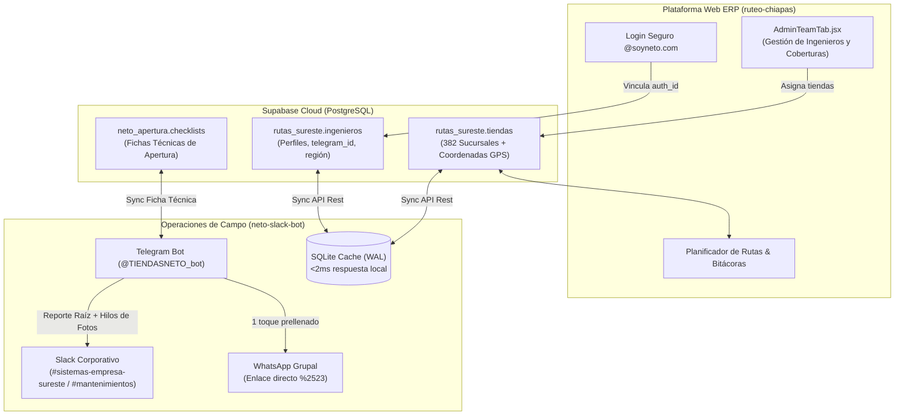

# 🤖 Integración del Ecosistema: Plataforma Web Ruteo Sureste ⟷ Bot Telegram/Slack

Este documento describe la arquitectura y el procedimiento operativo para la integración entre la plataforma web **Rutas Sureste** (`ruteo-chiapas`) y el bot de campo **Neto Slack Bot** (`neto-slack-bot`).

Ambos sistemas comparten una **Fuente Única de la Verdad** alojada en **Supabase Cloud (PostgreSQL + PostGIS)** en el esquema `rutas_sureste`.

---

## 🏗️ 1. Diagrama de Arquitectura del Ecosistema



---

## 📊 2. Esquema Unificado de Base de Datos

### Tabla `rutas_sureste.ingenieros`
| Campo | Tipo | Descripción |
| :--- | :--- | :--- |
| `id` | `bigint` (PK) | Identificador único del ingeniero (1: Herwing, 2: Brayan, 3: Roman, 4: Victor, 5: Omar, 12: Juan Andrés). |
| `nombre` | `text` (Unique) | Nombre completo oficial del ingeniero. |
| `email` | `text` | Correo corporativo `@soyneto.com`. |
| `auth_id` | `uuid` | Identificador de autenticación de Supabase Auth. |
| `telegram_id` | `bigint` (Unique) | **Chat ID de Telegram** para autenticación directa sin contraseñas en el bot. |
| `slack_token` | `text` | Token `xoxb-...` del ingeniero para publicar con su propio perfil en Slack (opcional, fallback a token general). |
| `region` | `text` | Región operativa asignada (`CHIAPAS`, `TABASCO`, `YUCATAN`, `CHIAPAS SOCONUSCO`, `COATZA OLMECA`). |
| `rol` | `text` | `admin`, `ingeniero`, `coordinador`. |

### Tabla `rutas_sureste.tiendas`
* **382 tiendas** clasificadas por `region`, `zona` y asignadas directamente a un `ingeniero_id`.
* Incluye coordenadas `lat` y `lng` de alta precisión utilizadas tanto para el ruteo web como para los reportes de llegada con GPS en Slack.

---

## 🚀 3. Guía de Alta de Nuevos Ingenieros

Para incorporar a un nuevo ingeniero al ecosistema sin tocar código ni reiniciar servidores:

### Paso 1: Registro en la Plataforma Web
1. El ingeniero ingresa a la plataforma web de Ruteo y crea su cuenta con su correo oficial `@soyneto.com`.
2. El sistema lo vincula automáticamente con su perfil en `rutas_sureste.ingenieros`.

### Paso 2: Obtener el `telegram_id`
1. El ingeniero abre Telegram y busca el bot oficial de información [@userinfobot](https://t.me/userinfobot) (o simplemente presiona `/start` en el bot de Neto).
2. El bot le responderá con su número de **Id** (por ejemplo: `8757351329`).

### Paso 3: Asignar el `telegram_id` en Supabase
El Administrador puede asociar el Telegram ID de dos formas:
* **Desde Supabase SQL / Dashboard:**
  ```sql
  UPDATE rutas_sureste.ingenieros
  SET telegram_id = 123456789
  WHERE email = 'nuevo.ingeniero@soyneto.com';
  ```
* **O directamente desde el menú del Bot de Telegram:**
  Entra a `/start` ➡️ **👥 Panel Admin** ➡️ **➕ Agregar / Actualizar Ingeniero** y envía:
  `123456789 | NOMBRE INGENIERO | DEFAULT`

### Paso 4: Sincronización en 1 Toque
1. En el bot de Telegram, el Administrador o cualquier ingeniero toca:
   **`🔄 Sincronizar desde Supabase Cloud (382 Tiendas)`**.
2. En menos de **1 segundo**, el bot descarga las 382 tiendas y asigna al nuevo ingeniero **únicamente las sucursales de su región**.

---

## 📱 4. Experiencia del Ingeniero en Campo

Cuando un ingeniero autenticado envía `/start` al bot:
1. **Filtro automático:** El menú principal le muestra **`👤 Mis Sucursales`** conteniendo exclusivamente las tiendas de su cobertura geográfica.
2. **Cobertura de compañeros:** Si debe cubrir a otro ingeniero, tiene acceso al botón **`🌐 Ver toda la Región (382)`** o al **`🔍 Buscador Directo`** por nombre o número económico.
3. **Flujos soportados:**
   - **Llegada y Traslado Estándar:** Con botón directo para compartir en WhatsApp.
   - **Mantenimiento Preventivo:** Carga por etapas (Antes ➡️ Después ➡️ Adicionales) con particionado automático en bloques de 10 fotos dentro del hilo de Slack.
   - **Implementación por Apertura:** Llegada con 4 fotos obligatorias (`1_Fachada`, `2_Frente`, `3_Izquierda`, `4_Derecha`) y conclusión técnica interactiva con más de 80 fotografías en hilo.
